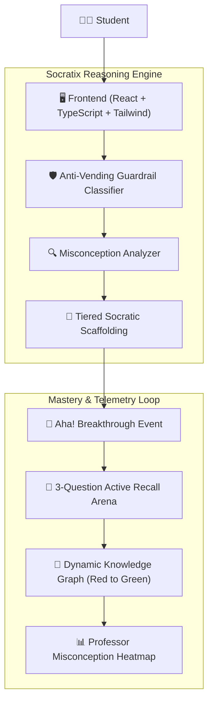

# 🧠 SOCRATIX: Socratic AI Active-Recall Learning Platform

> **Theme:** Smart Education & AI Pedagogy  
> **Mission:** Transforming Generative AI from an *academic crutch* into an *active recall catalyst*.  
> **Live Local App:** [http://127.0.0.1:3000](http://127.0.0.1:3000)

[](https://www.typescriptlang.org/)
[](https://react.dev/)
[](https://tailwindcss.com/)
[](https://vitejs.dev/)

---

## 🎯 The Core Problem

Current Generative AI systems (ChatGPT, Claude, Copilot) operate as **"answer vending machines"**:
1. Students paste homework problems.
2. AI spits out complete code and proofs.
3. Students copy-paste without cognitive engagement.
4. Midterm failure rates in proctored settings remain high, and students fail technical interviews due to the **"Illusion of Competence"**.

```text
[Typical AI]  Student asks for code  ──> AI dumps 100 lines of code ──> Passive Copy-Paste ──> Zero Retention (F grade)
[Socratix]    Student asks for code  ──> AI isolates misconception  ──> Guided Deduction   ──> Active Recall Verified (A grade)
```

---

## 💡 The Socratix Solution

**SOCRATIX** enforces strict Socratic pedagogical constraints:
* 🛡️ **Anti-Vending Guardrails:** Politely refuses to write complete solutions or raw code; instead asks the single question needed to uncover the first step.
* 🔍 **Cognitive Misconception Extraction:** Analyzes student submissions for foundational misconceptions (e.g., pointer orphans, boundary conditions, rate of change expansion).
* 🪜 **3-Tiered Scaffolding:** Sequential hints only upon request:
  1. *Level 1:* Conceptual Guiding Question
  2. *Level 2:* Counter-Example / Edge-case Demonstration
  3. *Level 3:* Structural Skeleton / Outline
* 📝 **Adaptive Active-Recall Quizzes:** Instant 3-question retention checks once the student unlocks their *"Aha!"* breakthrough.
* 🌲 **Dynamic Knowledge Graph:** Visual concept DAG where nodes transition in real-time from 🔴 **Misconception** to 🟡 **In-Progress** to 🟢 **Verified Mastery**.
* 📊 **Classroom Misconception Heatmap:** Aggregates class-wide struggle metrics for professors to plan targeted lecture interventions.

---

## 🏗️ System Architecture & Cognitive Loop



---

## 🧪 Interactive STEM Multi-Topic Labs

Socratix supports multi-disciplinary STEM learning with built-in scenario labs:

| Topic | Subject | Core Misconception | Socratic Discovery |
| :--- | :--- | :--- | :--- |
| **BST Node Deletion** | Data Structures (CS 201) | Deleting 2-child node orphans subtrees | Deducing **In-Order Successor** preserves BST ordering |
| **Product Rule** | Calculus (MATH 101) | Multiplying derivatives directly $(u' \cdot v')$ | Proving dual rate of area expansion $(u'v + uv')$ |
| **High-Throughput Reads** | Distributed Systems (SYS 401) | Adding 25 read replicas causes replication lag | Designing **Cache-Aside** tier with Redis |

---

## 🚀 Quickstart & Setup

### Prerequisites
* Node.js v18+ (tested on Node v24)
* npm v9+

### Installation

```bash
# Clone the repository
git clone https://github.com/KLP13/SOCRATIX-Socratic-AI-Active-Recall-Learning-Platform.git
cd SOCRATIX-Socratic-AI-Active-Recall-Learning-Platform

# Install dependencies
npm install

# Start local development server
npm run dev
```

Open your browser at **[http://127.0.0.1:3000](http://127.0.0.1:3000)**.

---

## 🎤 3-Minute Winning Pitch Guide

1. **0:00 - 0:30 (The Hook):** Show the Landing Page comparison (*Typical AI Answer Dump* vs. *Socratix Misconception Catch*).
2. **0:30 - 1:30 (The Socratic Journey):** Navigate to `/workspace`. Type `"Give me the answer"` to demo the Anti-Vending Guardrail. Click **"⚡ Demo Breakthrough"** to trigger the *"Aha!"* breakthrough.
3. **1:30 - 2:15 (Active Recall Retention):** Take the 3-question quiz on `/quiz`. Show instant feedback, scoring, XP award, and confetti explosion.
4. **2:15 - 2:45 (Institutional Value):** Show `/mastery` turning from 🔴 to 🟢, and open `/educator` to showcase the class struggle heatmap drop and AI talking points for the professor.
5. **2:45 - 3:00 (Closing):** *"Socratix transforms AI from a cheating crutch into the ultimate scalable Socratic tutor."*

---

## 📄 License
MIT License. Built for Smart Education Hackathons.
