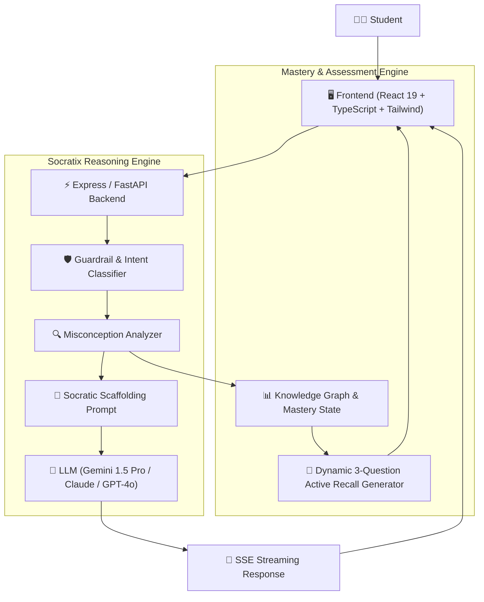

# 🧠 SOCRATIX: Socratic AI Active-Recall Learning Platform
### Comprehensive Problem Statement, System Architecture & Product Specification
**Theme:** Smart Education | **Target Event:** Hackathon Submission  
**File Name:** `SOCRATIC_AI_SMART_EDUCATION_SPECIFICATION.md`

---

## 📋 Table of Contents
1. [Executive Summary](#1-executive-summary)
2. [Problem Statement & Background](#2-problem-statement--background)
3. [Target Personas](#3-target-personas)
4. [Solution Overview & Key Innovations](#4-solution-overview--key-innovations)
5. [System Architecture & Data Flow](#5-system-architecture--data-flow)
6. [Complete Page-by-Page Specifications](#6-complete-page-by-page-specifications)
7. [Detailed Feature & Functional Requirements](#7-detailed-feature--functional-requirements)
8. [Technical Stack & API Design](#8-technical-stack--api-design)
9. [3-Minute Winning Hackathon Pitch & Demo Script](#9-3-minute-winning-hackathon-pitch--demo-script)
10. [Judging Criteria Alignment Matrix](#10-judging-criteria-alignment-matrix)

---

## 1. Executive Summary

Current Generative AI systems (ChatGPT, Claude, Copilot) operate as **"answer vending machines"**: students paste homework problems, the AI spits out completed code and essays, and students copy-paste the output without cognitive engagement. As a result, professors are banning AI, exam failure rates in proctored settings remain high, and students fail technical interviews.

**SOCRATIX** is a transformative Smart Education platform that turns GenAI from an *academic crutch* into an *active recall catalyst*. Powered by modern LLMs configured with strict Socratic reasoning constraints, Socratix **refuses to hand out direct answers**. Instead, it identifies the student’s exact logical misconception, asks targeted diagnostic questions, guides them to their own "aha!" breakthrough, and instantly generates an adaptive retention quiz to verify mastery.

---

## 2. Problem Statement & Background

### 2.1 The Core Dilemma
* **The "Illusion of Competence":** Reading a generated answer makes students *feel* like they understand, but according to Bloom's Revised Taxonomy, passive absorption produces near-zero long-term retention.
* **The Educator Backlash:** Educators and universities are frustrated by rampant assignment plagiarism and lack of authentic assessment.
* **The Socratic Method Bottleneck:** One-on-one Socratic teaching—where an expert instructor guides a student step-by-step through questioning—is the most effective teaching methodology in history, but it does not scale to university classes of 200+ students.

### 2.2 The Hackathon Problem Statement
> *"How can we leverage conversational AI and adaptive cognitive feedback loops to deliver scalable, personalized Socratic tutoring that promotes deep conceptual mastery rather than passive answer-seeking?"*

---

## 3. Target Personas

| Persona | Role | Pain Point | How Socratix Solves It |
| :--- | :--- | :--- | :--- |
| **Alex (Student)** | 2nd Year Computer Science / Engineering | Gets stuck on data structures; uses ChatGPT to get the code, but fails midterms because he can't explain why it works. | Acts as an empathetic, 24/7 Socratic tutor that walks him step-by-step through algorithm logic until he writes the code himself. |
| **Prof. Mehta (Educator)** | University Professor | Cannot tell if students are understanding course materials; spends hours fielding the same beginner questions during office hours. | Receives aggregated class "Misconception Heatmaps" showing exactly which topics the class struggled with. |
| **Campus Peer Tutor** | Senior Student Mentor | Spends half of 1-on-1 tutoring sessions explaining basic prerequisites rather than advanced problem-solving. | Refers learners to pre-tutoring Socratic drills so 1-on-1 sessions are focused on high-level guidance. |

---

## 4. Solution Overview & Key Innovations

1. **Strict Guardrail "Anti-Vending Machine" Engine:**
   - Detects when a prompt is asking for complete homework solutions and redirects the conversation into guided problem deconstruction.
2. **Cognitive Misconception Detection:**
   - Analyzes student inputs for foundational misconceptions (e.g., confusing pointers with references, off-by-one boundary conditions, recursion termination).
3. **Dynamic Scaffolding & Tiered Hints:**
   - Level 1: Conceptual Question (nudges student to examine a specific rule).
   - Level 2: Counter-example / Edge-case Demonstration.
   - Level 3: Skeleton / Scaffolded Outline (leaves key gaps for student to fill).
4. **Adaptive Active-Recall Verification (Micro-Quiz):**
   - Once the student solves the problem, Socratix creates a 3-question conceptual quiz testing the exact logic they just unlocked.
5. **Interactive Knowledge Graph:**
   - Visual map showing student concept nodes changing from "Red" (Misconception) to "Yellow" (In-Progress) to "Green" (Mastered).

---

## 5. System Architecture & Data Flow



---

## 6. Complete Page-by-Page Specifications

### Page 1: Landing & Interactive Socratic Playground (`/`)
* **Purpose:** Immediately hook the visitor/judge with a live demonstration of the difference between standard AI and Socratic AI.
* **Key UI Components:**
  - **Hero Section:** Headline: *"Stop Copying Answers. Start Mastering Concepts."*
  - **Interactive Split-Screen Sandbox:**
    - Left Side: "Standard AI" (Shows ChatGPT dumping full code).
    - Right Side: "Socratix" (Shows conversational Socratic questioning leading to breakthrough).
  - **Topic Selector:** Quick buttons to launch demo sessions (e.g., *Binary Search Trees*, *Recursion*, *Thermodynamics*, *Organic Chemistry*).
  - **CTA Button:** *"Start Socratic Session (No Sign-In Required for Demo)"*.

---

### Page 2: Socratic Diagnostic Workspace (`/learn/:topicId` or `/workspace`)
* **Purpose:** The primary student interaction screen where active learning takes place.
* **Layout Structure:**
  - **Left Panel (Problem Context & Scratchpad):**
    - Problem description / question prompt.
    - Code editor or LaTeX formula editor with line numbering.
    - "Test My Thinking" action button.
  - **Right Panel (Socratic Dialogue Stream):**
    - Chat thread with the Socratic AI.
    - **Current Cognitive Step Badge** (e.g., *Phase 1: Understanding Constraints*, *Phase 2: Edge-case Exploration*, *Phase 3: Implementation*).
    - **Tiered Hint Bar:**
      - Button: `Need a subtle hint? (0/3 used)`
    - **Guardrail Banner:** Subtle reminder: *"Socratix will never give you the raw answer. You are in the driver's seat."*

---

### Page 3: Real-Time Concept & Misconception Graph (`/mastery`)
* **Purpose:** Visual progress tracking demonstrating academic progression.
* **Key UI Components:**
  - **Interactive Canvas / Force Graph:**
    - Visual nodes representing concepts (e.g., `Pointers`, `Memory Allocation`, `Linked Lists`, `Binary Trees`).
    - Node status:
      - 🔴 **Misconception Identified** (Click to see what mistake was repeatedly made).
      - 🟡 **Under Scaffolding** (In progress).
      - 🟢 **Verified Mastery** (Passed spaced-recall quizzes).
  - **Misconception Log Drawer:**
    - Summarizes recurring bugs in student logic (e.g., *"Tends to forget loop termination condition when $i=0$ "*).

---

### Page 4: Spaced-Recall "Mastery Arena" Quiz (`/quiz/:sessionId`)
* **Purpose:** Post-session verification to cement learning before credits or badges are awarded.
* **Key UI Components:**
  - **Countdown / Focus Mode:** Distraction-free quiz card.
  - **3 Tailored Questions:**
    - Question 1: Conceptual check (identifying why the mistake was flawed).
    - Question 2: Edge case prediction (what happens if input is empty?).
    - Question 3: Code/formula transfer question (apply the rule to a new scenario).
  - **Score & Mastery Badge:**
    - If score $\ge 80\%$: Awards "+10 Mastery XP" and unlocks the next node on the Skill Tree.
    - If score $< 80\%$: Re-engages the Socratic tutor for targeted review.

---

### Page 5: Educator & Analytics Dashboard (`/educator`)
* **Purpose:** Showcases the institutional/B2B monetization potential for university hackathon judges.
* **Key UI Components:**
  - **Classroom Misconception Heatmap:** Aggregates class-wide data (e.g., *"68% of students in CS201 struggled with recursion base cases this week"*).
  - **At-Risk Student Alerts:** Highlights students exhibiting continuous conceptual dead-ends.
  - **Curriculum Feedback Recommendations:** Generates suggested lecture talking points based on real student struggle patterns.

---

## 7. Detailed Feature & Functional Requirements

### 7.1 Socratic Prompting Engine Requirements
* **FR-1.1 (Anti-Vending Enforcement):** If a student submits `"Write the code for X"` or `"Give me the solution to this question"`, the system must reject the direct answer and respond with:
  > *"I can certainly help you solve X! Before we write the implementation, what is your understanding of the primary constraint of this problem?"*
* **FR-1.2 (Misconception Extraction):** Every student message must be classified into:
  - `Correct Logic`
  - `Syntax Confusion`
  - `Core Conceptual Misconception`
  - `Edge-Case Blindspot`
* **FR-1.3 (Progressive Hint Scaffolding):** Hints must only be provided sequentially upon explicit request, moving from high-level questions to structural outlines.

### 7.2 UI/UX Requirements
* **FR-2.1 (Low Latency Streaming):** Conversational responses must stream with sub-400ms time-to-first-token (TTFT).
* **FR-2.2 (Code & Math Highlighting):** Support syntax highlighting for 10+ languages (Python, Java, C++, TypeScript, etc.) and LaTeX formatting for mathematical expressions.
* **FR-2.3 (Responsive Design):** Fully functional on tablet/mobile for on-the-go study sessions.

---

## 8. Technical Stack & API Design

### 8.1 Recommended Tech Stack
* **Frontend:** React 19 + TypeScript + Vite + Tailwind CSS + Framer Motion (for smooth node animations)
* **Backend:** Node.js (Express / Fastify) or Python (FastAPI)
* **AI Model:** Google Gemini 1.5 Pro / Flash (ideal for large context windows and fast Socratic streaming)
* **Database:** PostgreSQL with Prisma ORM (User profiles, mastery nodes, session logs)
* **Visual Graph Engine:** React Flow (`@xyflow/react`) or D3.js for the dynamic concept tree

### 8.2 Socratic Prompt Template (Production-Ready)
```text
You are SOCRATIX, an elite university-level Socratic tutor specialized in STEM education.
Your goal is to guide the student to discover the answer themselves.

STRICT CONSTRAINTS:
1. NEVER provide the complete solution, raw final code, or complete mathematical proof.
2. If the user asks for the answer, politely refuse and ask a guiding question about the first step.
3. Keep responses concise (under 3 sentences whenever possible). Ask only ONE question at a time.
4. Pinpoint the user's specific conceptual misconception and provide a targeted analogy or counter-example.
5. Praise genuine breakthroughs and immediately transition to testing their edge-case understanding.
```

---

## 9. 3-Minute Winning Hackathon Pitch & Demo Script

| Time | Script / Action | Visual on Screen |
| :--- | :--- | :--- |
| **0:00 - 0:30** | *"Judges, generative AI was supposed to revolutionize education. Instead, it became an answer vending machine. Students copy-paste homework, learn nothing, and fail exams. Professors are banning AI. But what if AI refused to do the homework for you, and instead taught you how to think?"* | Show meme/slide of ChatGPT giving 100 lines of code vs. red F grade on midterms. |
| **0:30 - 1:30** | *"Meet Socratix. Let's ask it to write binary tree deletion for us."* <br>Type: `"Write binary tree deletion in C++"`.<br>*"Notice: It refuses. Instead, it asks: 'What happens when a node has two children?' We type a common wrong answer: 'Just delete it and link left child.' Watch this: It instantly catches our misconception and presents an edge-case contradiction."* | Live demo of Socratic chat detecting the exact error and guiding user to correct logic. |
| **1:30 - 2:15** | *"Once we deduce the correct algorithm ourselves, Socratix doesn't just stop. It instantly generates an active recall mini-quiz to lock in retention."* | Complete the 3-question quiz, showing score and instant mastery XP unlock. |
| **2:15 - 2:45** | *"Over time, this powers the student's personal Knowledge Tree and gives professors a class-wide Misconception Heatmap, showing exactly where lectures need reinforcement."* | Show interactive visual Concept Graph turning from red to green. |
| **2:45 - 3:00** | *"Socratix transforms AI from a cheating tool into the ultimate scalable Socratic tutor. Thank you!"* | Q&A transition. |

---

## 10. Judging Criteria Alignment Matrix

| Criterion | How Socratix Wins |
| :--- | :--- |
| **Innovation & Originality** | Inverts the common GenAI use case: instead of generating answers, it systematically withholds them and guides inquiry. |
| **Theme Fit (Smart Education)** | Embodies true pedagogy (Bloom's Taxonomy, Socratic questioning, active recall, spaced repetition). |
| **Technical Execution** | Combines constrained LLM prompt chaining, streaming responses, and an interactive React Flow knowledge graph. |
| **Market & Social Impact** | Solves the academic integrity crisis for universities while accelerating authentic student learning. |

---

*This document is ready for distribution, submission documentation, and development planning.*
